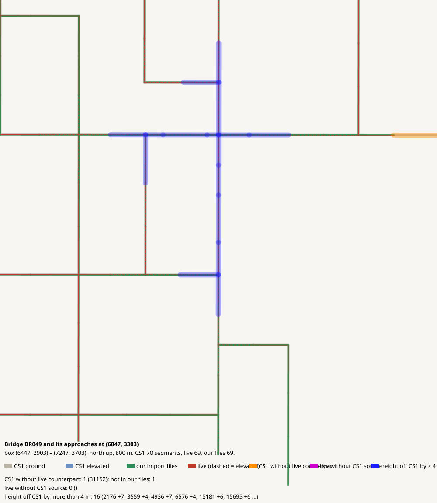

# Bridge BR049 and its approaches at (6847, 3303)

CHECK: 1 CS1 segments without live counterpart, 0 live without CS1 source, 16 more than 4 m off the CS1 height, 0 live dead ends CS1 did not have

| CS1 segment | prefab | elevation | in our files | live | converter fate |
|---|---|---:|---|---|---|
| 31152 | Gravel Road | 0 | no | missing | collapsed (< 4 m) |

| live segment | prefab | elevation |
|---|---|---:|

| CS1 segment | prefab | CS1 y | live | live − CS1 m |
|---|---|---:|---|---:|
| 2176 | Gravel Road | 139.4 | all:e2176_0 Gravel Road | 6.9 |
| 3559 | Gravel Road | 139.4 | all:e3559_0 Gravel Road | 4.1 |
| 4936 | Gravel Road Elevated | 139.4 | bridges:br049_c1_e0 Wooden Covered Bridge - 2 lanes | 7.3 |
| 6576 | Gravel Road | 139.4 | all:e6576_0 Gravel Road | 4.4 |
| 15181 | Gravel Road | 139.4 | all:e15181_0 Gravel Road | 6.4 |
| 15695 | Gravel Road | 139.4 | all:e15695_0 Gravel Road | 5.8 |
| 16440 | Gravel Road | 139.4 | all:e16440_0 Gravel Road | 4.0 |
| 16845 | Gravel Road | 139.4 | all:e16845_0 Gravel Road | 4.5 |
| 22119 | Gravel Road | 139.4 | all:e22119_0 Gravel Road | 4.4 |
| 22541 | Gravel Road | 139.4 | all:e22541_0 Gravel Road | 7.3 |
| 23842 | Gravel Road | 139.4 | all:e23842_0 Gravel Road | 5.3 |
| 24516 | Gravel Road Elevated | 139.4 | bridges:br050_c1_e0 Wooden Covered Bridge - 2 lanes | 7.5 |
| 24652 | Gravel Road | 139.4 | all:e24652_0 Gravel Road | 7.3 |
| 24804 | Gravel Road | 139.4 | all:e24804_0 Gravel Road | 4.3 |
| 34293 | Gravel Road | 139.4 | all:e34293_0 Gravel Road | 8.4 |
| 35314 | Gravel Road | 139.4 | all:e35314_0 Gravel Road | 6.7 |
