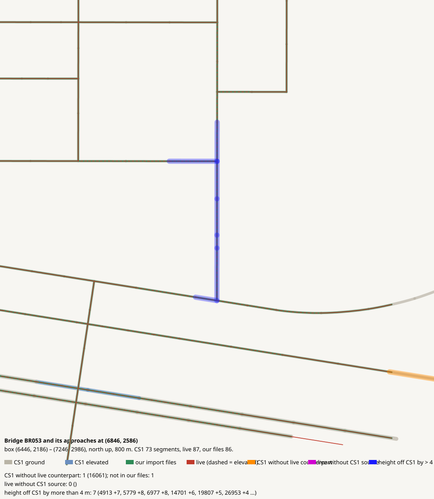

# Bridge BR053 and its approaches at (6846, 2586)

CHECK: 1 CS1 segments without live counterpart, 0 live without CS1 source, 7 more than 4 m off the CS1 height, 0 live dead ends CS1 did not have

| CS1 segment | prefab | elevation | in our files | live | converter fate |
|---|---|---:|---|---|---|
| 16061 | R2USA W GrWo 2x2 | 0 | no | missing | folded into its neighbour (short border edge) |

| live segment | prefab | elevation |
|---|---|---:|

| CS1 segment | prefab | CS1 y | live | live − CS1 m |
|---|---|---:|---|---:|
| 4913 | Gravel Road | 139.4 | all:e4913_0 Gravel Road | 7.2 |
| 5779 | Gravel Road Elevated | 139.4 | bridges:br053_c1_e0 Wooden Covered Bridge - 2 lanes | 8.3 |
| 6977 | Gravel Road | 139.4 | all:e6977_0 Gravel Road | 8.0 |
| 14701 | Gravel Road | 139.4 | all:e14701_0 Gravel Road | 6.2 |
| 19807 | Gravel Road | 139.4 | all:e19807_0 Gravel Road | 5.0 |
| 26953 | USRP 2-Lane National Road | 139.4 | all:e26953_0 Highway Twoway - 2 lanes | 4.1 |
| 28281 | Gravel Road | 139.4 | all:e28281_0 Gravel Road | 4.8 |
