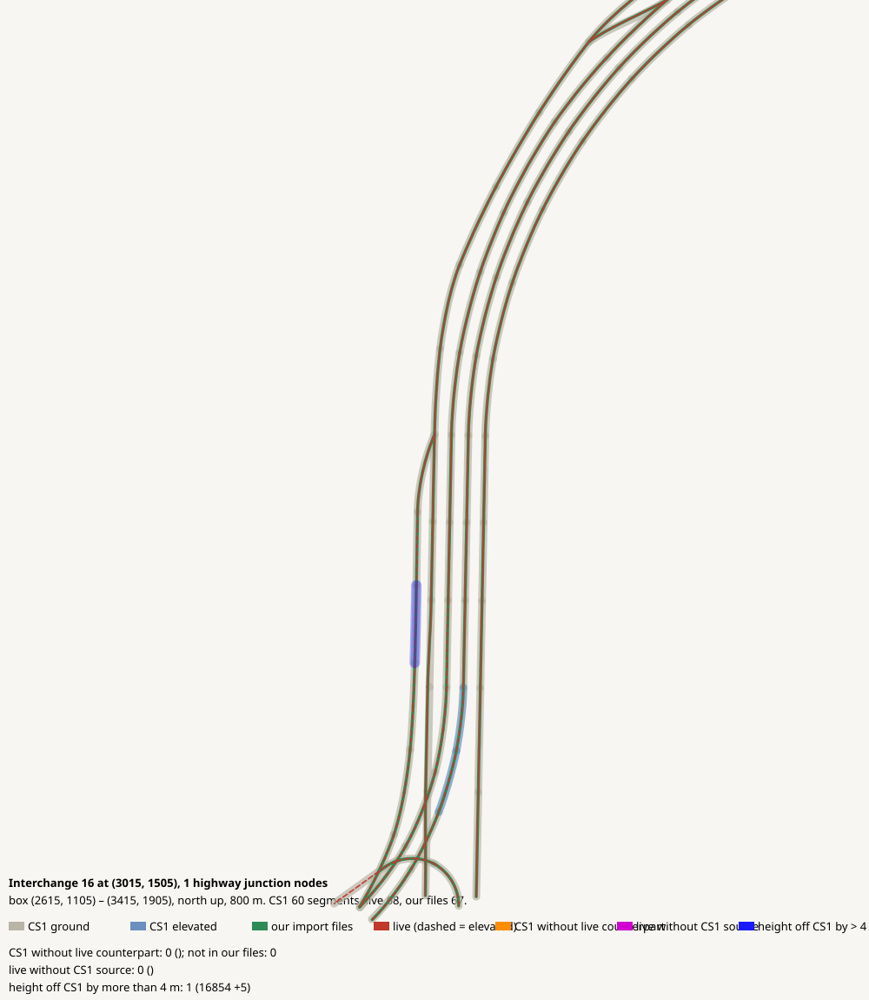

# Interchange 16 at (3015, 1505), 1 highway junction nodes

CHECK: 0 CS1 segments without live counterpart, 0 live without CS1 source, 1 more than 4 m off the CS1 height, 0 live dead ends CS1 did not have

| CS1 segment | prefab | elevation | in our files | live | converter fate |
|---|---|---:|---|---|---|

| live segment | prefab | elevation |
|---|---|---:|

| CS1 segment | prefab | CS1 y | live | live − CS1 m |
|---|---|---:|---|---:|
| 16854 | USRP 1L Interstate Ramp E | 151.6 | all:e16854_0 Highway Oneway - 1 lane | 5.1 |
