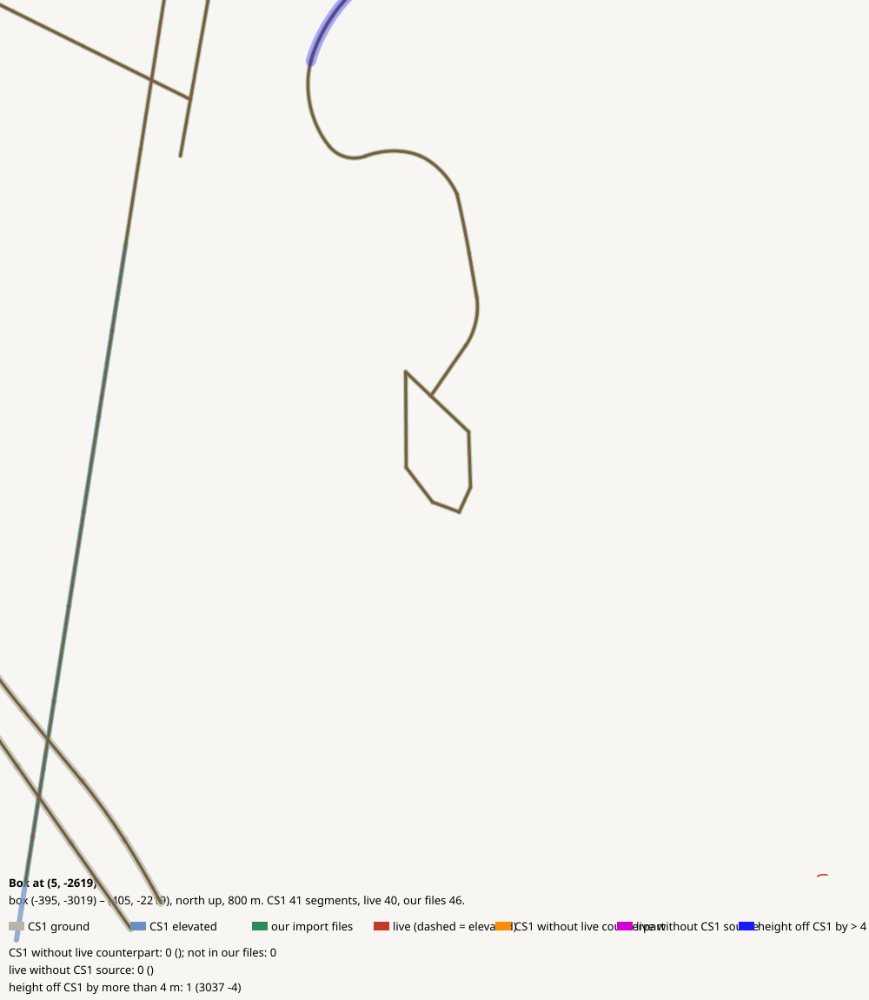

# Box at (5, -2619)

CHECK: 0 CS1 segments without live counterpart, 0 live without CS1 source, 1 more than 4 m off the CS1 height, 0 live dead ends CS1 did not have

| CS1 segment | prefab | elevation | in our files | live | converter fate |
|---|---|---:|---|---|---|

| live segment | prefab | elevation |
|---|---|---:|

| CS1 segment | prefab | CS1 y | live | live − CS1 m |
|---|---|---:|---|---:|
| 3037 | Gravel Road | 148.3 | 75865:25 Gravel Road | -4.0 |
