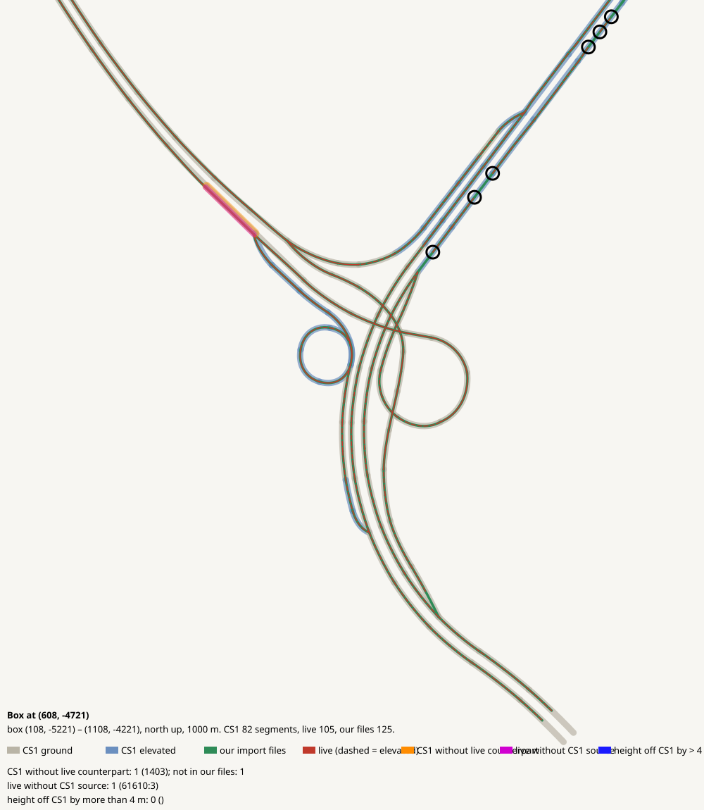

# Box at (608, -4721)

CHECK: 1 CS1 segments without live counterpart, 1 live without CS1 source, 2 more than 4 m off the CS1 height, 4 live dead ends CS1 did not have ((808, -4467) (723, -4579) (884, -4339) (782, -4501))

| CS1 segment | prefab | elevation | in our files | live | converter fate |
|---|---|---:|---|---|---|
| 15883 | USRP 4L Interstate | 0 | no | missing | imported |

| live segment | prefab | elevation |
|---|---|---:|
| 109218:13 | Highway Oneway - 3 lanes | 0.0 |

| CS1 segment | prefab | CS1 y | live | live − CS1 m |
|---|---|---:|---|---:|
| 17897 | USRP 3L Interstate E | 139.3 | 65379:5 Highway Oneway - 3 lanes | 13.1 |
| 31688 | USRP 3L Interstate E | 139.4 | 64698:33 Highway Oneway - 3 lanes | 12.8 |
