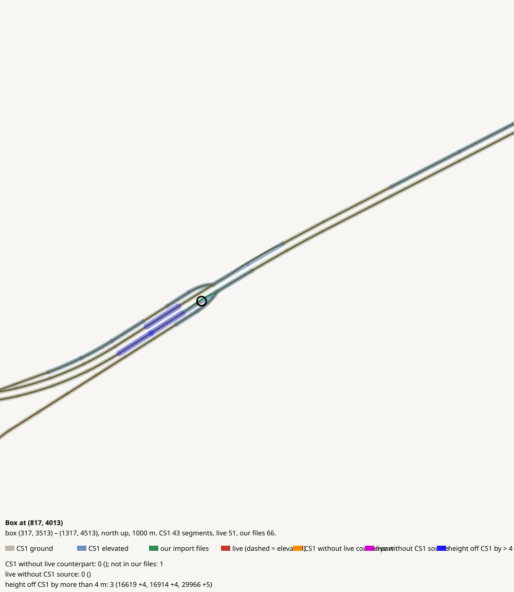

# Box at (817, 4013)

CHECK: 1 CS1 segments without live counterpart, 0 live without CS1 source, 3 more than 4 m off the CS1 height, 0 live dead ends CS1 did not have

| CS1 segment | prefab | elevation | in our files | live | converter fate |
|---|---|---:|---|---|---|
| 22564 | USRP 2L Interstate E | 10 | no | missing | imported |

| live segment | prefab | elevation |
|---|---|---:|

| CS1 segment | prefab | CS1 y | live | live − CS1 m |
|---|---|---:|---|---:|
| 16619 | USRP 2L Interstate E | 170.2 | 66185:17 Highway Oneway - 2 lanes | 4.4 |
| 16914 | USRP 2L Interstate E | 169.1 | 66277:9 Highway Oneway - 2 lanes | 4.5 |
| 29966 | USRP 2L Interstate E | 169.1 | 64947:13 Highway Oneway - 2 lanes | 4.8 |
