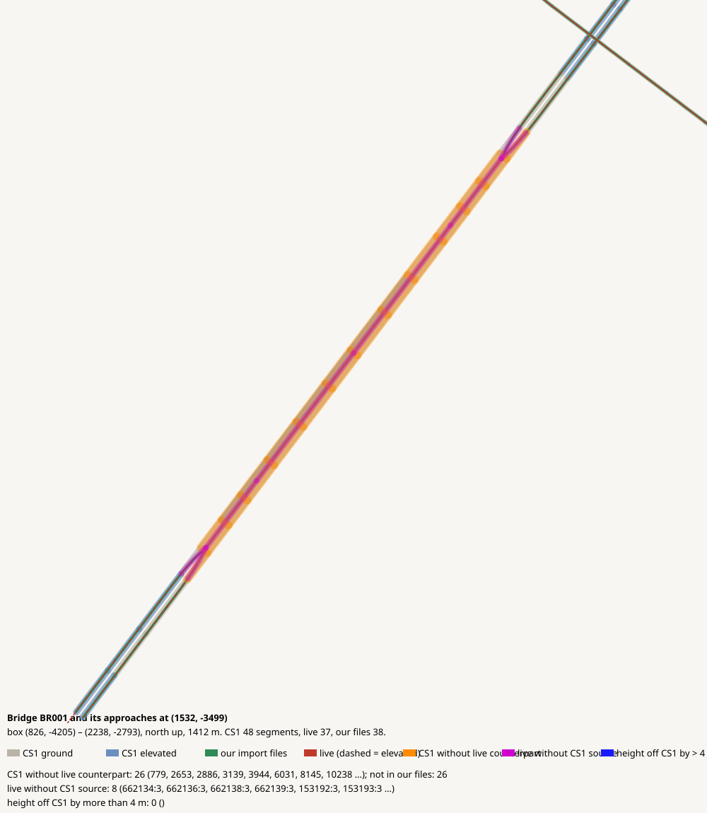

# Bridge BR001 and its approaches at (1532, -3499)

CHECK: 0 CS1 segments without live counterpart (+28 replaced by a bridge override), 8 live without CS1 source, 2 more than 4 m off the CS1 height

| CS1 segment | prefab | elevation | in our files | live | converter fate |
|---|---|---:|---|---|---|
| 779 | USRP 3L Interstate B | 0 | no | missing | bridge override (import-bridges*.json) |
| 2653 | USRP 3L Interstate B | 0 | no | missing | bridge override (import-bridges*.json) |
| 2886 | USRP 3L Interstate B | 1 | no | missing | bridge override (import-bridges*.json) |
| 3139 | USRP 3L Interstate B | 0 | no | missing | bridge override (import-bridges*.json) |
| 3389 | USRP 3L Interstate B | 0 | no | missing | bridge override (import-bridges*.json) |
| 3944 | USRP 3L Interstate B | 0 | no | missing | bridge override (import-bridges*.json) |
| 6031 | USRP 3L Interstate B | 0 | no | missing | bridge override (import-bridges*.json) |
| 8145 | USRP 3L Interstate B | 0 | no | missing | bridge override (import-bridges*.json) |
| 10238 | USRP 3L Interstate B | 0 | no | missing | bridge override (import-bridges*.json) |
| 12548 | USRP 3L Interstate B | 0 | no | missing | bridge override (import-bridges*.json) |
| 12774 | USRP 3L Interstate B | 0 | no | missing | bridge override (import-bridges*.json) |
| 13146 | USRP 3L Interstate B | 0 | no | missing | bridge override (import-bridges*.json) |
| 14397 | USRP 3L Interstate B | 0 | no | missing | bridge override (import-bridges*.json) |
| 15986 | USRP 3L Interstate B | 0 | no | missing | bridge override (import-bridges*.json) |
| 16165 | USRP 3L Interstate B | 1 | no | missing | bridge override (import-bridges*.json) |
| 16506 | USRP 3L Interstate B | 1 | no | missing | bridge override (import-bridges*.json) |
| 16555 | USRP 3L Interstate B | 0 | no | missing | bridge override (import-bridges*.json) |
| 17800 | USRP 3L Interstate B | 1 | no | missing | bridge override (import-bridges*.json) |
| 20401 | USRP 3L Interstate B | 0 | no | missing | bridge override (import-bridges*.json) |
| 20556 | USRP 3L Interstate B | 0 | no | missing | bridge override (import-bridges*.json) |
| 23013 | USRP 3L Interstate B | 0 | no | missing | bridge override (import-bridges*.json) |
| 23795 | USRP 3L Interstate B | 0 | no | missing | bridge override (import-bridges*.json) |
| 26240 | USRP 3L Interstate B | 0 | no | missing | bridge override (import-bridges*.json) |
| 29014 | USRP 3L Interstate B | 0 | no | missing | bridge override (import-bridges*.json) |
| 32165 | USRP 3L Interstate B | 1 | no | missing | bridge override (import-bridges*.json) |
| 33371 | USRP 3L Interstate B | 1 | no | missing | bridge override (import-bridges*.json) |
| 33711 | USRP 3L Interstate B | 1 | no | missing | bridge override (import-bridges*.json) |
| 36659 | USRP 3L Interstate B | 0 | no | missing | bridge override (import-bridges*.json) |

| live segment | prefab | elevation |
|---|---|---:|
| 69644:25 | Highway Oneway - 3 lanes | 37.6 |
| 70200:15 | Highway Oneway - 3 lanes | 45.8 |
| 70204:15 | Highway Oneway - 3 lanes | 45.9 |
| 71646:7 | Highway Oneway - 3 lanes | 37.4 |
| 67937:3 | BXP SuspensionBridge03 - Six Lane Highway | 49.3 |
| 70201:15 | BXP SuspensionBridge03 - Six Lane Highway | 94.8 |
| 70202:15 | BXP SuspensionBridge03 - Six Lane Highway | 100.4 |
| 70203:15 | BXP SuspensionBridge03 - Six Lane Highway | 43.2 |

| CS1 segment | prefab | CS1 y | live | live − CS1 m |
|---|---|---:|---|---:|
| 14574 | USRP 3L Interstate E | 140.3 | 64661:3 Highway Oneway - 3 lanes | 37.7 |
| 35648 | USRP 3L Interstate E | 140.3 | 64743:3 Highway Oneway - 3 lanes | 38.0 |
