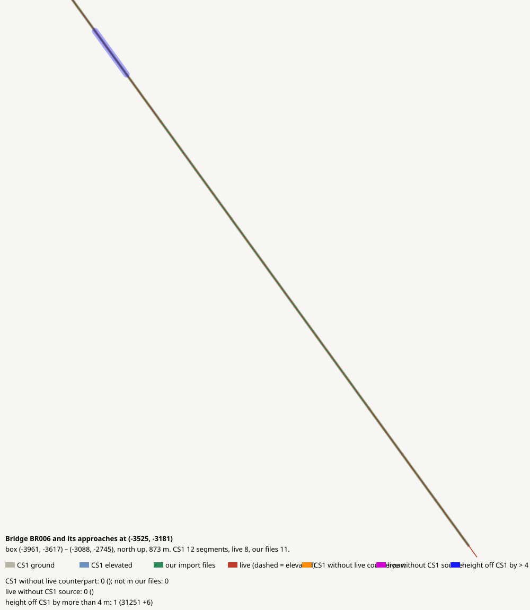

# Bridge BR006 and its approaches at (-3525, -3181)

CHECK: 0 CS1 segments without live counterpart, 0 live without CS1 source, 1 more than 4 m off the CS1 height

| CS1 segment | prefab | elevation | in our files | live | converter fate |
|---|---|---:|---|---|---|

| live segment | prefab | elevation |
|---|---|---:|

| CS1 segment | prefab | CS1 y | live | live − CS1 m |
|---|---|---:|---|---:|
| 31251 | USRP 2-Lane National Road | 283.1 | 99221:43 Small Road | 6.1 |
