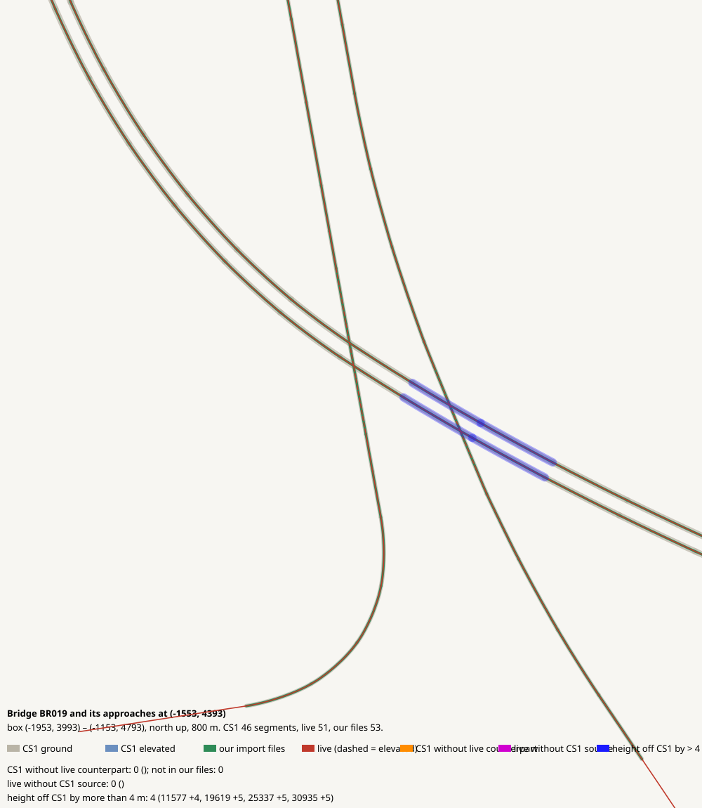

# Bridge BR019 and its approaches at (-1553, 4393)

CHECK: 0 CS1 segments without live counterpart, 0 live without CS1 source, 4 more than 4 m off the CS1 height

| CS1 segment | prefab | elevation | in our files | live | converter fate |
|---|---|---:|---|---|---|

| live segment | prefab | elevation |
|---|---|---:|

| CS1 segment | prefab | CS1 y | live | live − CS1 m |
|---|---|---:|---|---:|
| 11577 | USRP 3L Interstate | 195.7 | 65263:9 Highway Oneway - 3 lanes | 4.0 |
| 19619 | USRP 3L Interstate | 197.1 | 65605:3 Highway Oneway - 3 lanes | 4.6 |
| 25337 | USRP 3L Interstate | 197.1 | 66265:3 Highway Oneway - 3 lanes | 5.1 |
| 30935 | USRP 3L Interstate | 195.7 | 65601:9 Highway Oneway - 3 lanes | 4.8 |
