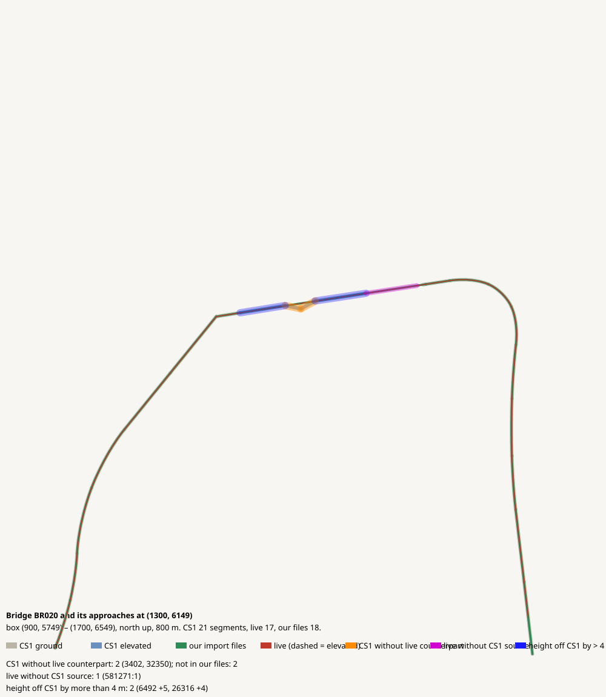

# Bridge BR020 and its approaches at (1300, 6149)

CHECK: 0 CS1 segments without live counterpart (+2 replaced by a bridge override), 1 live without CS1 source, 2 more than 4 m off the CS1 height, 0 live dead ends CS1 did not have

| CS1 segment | prefab | elevation | in our files | live | converter fate |
|---|---|---:|---|---|---|
| 3402 | Gravel Road Elevated | 1 | no | missing | bridge override (import-bridges*.json) |
| 32350 | Gravel Road Elevated | 1 | no | missing | bridge override (import-bridges*.json) |

| live segment | prefab | elevation |
|---|---|---:|
| 1657302:3 | Gravel Road | 9.8 |

| CS1 segment | prefab | CS1 y | live | live − CS1 m |
|---|---|---:|---|---:|
| 6492 | Gravel Road Bridge | 161.4 | 51790:5 Wooden Covered Bridge - 2 lanes | 5.1 |
| 26316 | Gravel Road Elevated | 161.4 | 51791:5 Wooden Covered Bridge - 2 lanes | 4.3 |
