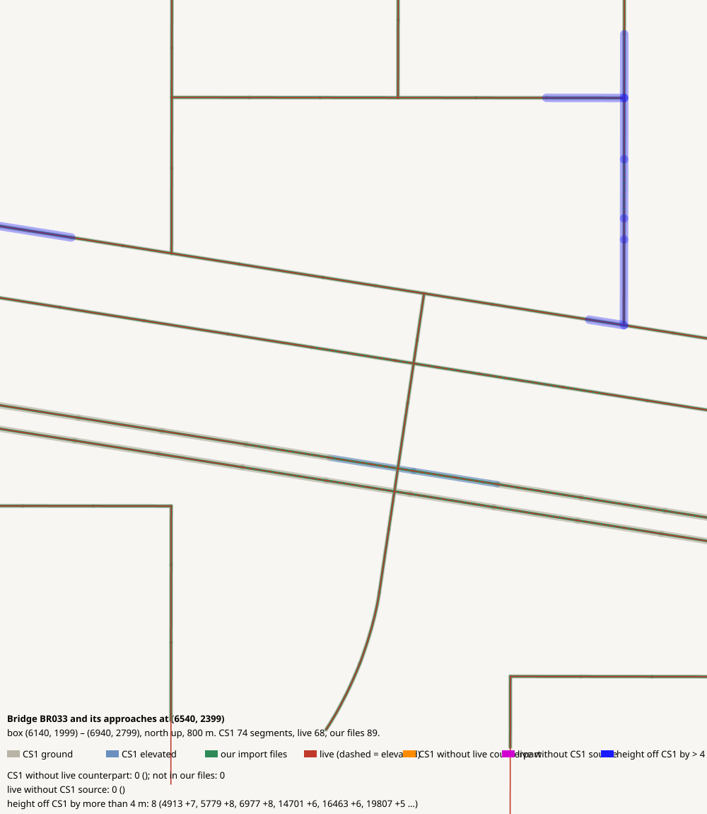

# Bridge BR033 and its approaches at (6540, 2399)

CHECK: 0 CS1 segments without live counterpart, 0 live without CS1 source, 8 more than 4 m off the CS1 height, 0 live dead ends CS1 did not have

| CS1 segment | prefab | elevation | in our files | live | converter fate |
|---|---|---:|---|---|---|

| live segment | prefab | elevation |
|---|---|---:|

| CS1 segment | prefab | CS1 y | live | live − CS1 m |
|---|---|---:|---|---:|
| 4913 | Gravel Road | 139.4 | 618815:1 Gravel Road | 7.2 |
| 5779 | Gravel Road Elevated | 139.4 | 578353:1 Wooden Covered Bridge - 2 lanes | 8.3 |
| 6977 | Gravel Road | 139.4 | 619289:1 Gravel Road | 8.2 |
| 14701 | Gravel Road | 139.4 | 619289:1 Gravel Road | 6.4 |
| 16463 | Gravel Road | 139.9 | 618984:1 Gravel Road | 6.0 |
| 19807 | Gravel Road | 139.4 | 618854:1 Gravel Road | 5.3 |
| 26953 | USRP 2-Lane National Road | 139.4 | 618538:1 Small Road | 4.4 |
| 28281 | Gravel Road | 139.4 | 618790:1 Gravel Road | 4.7 |
