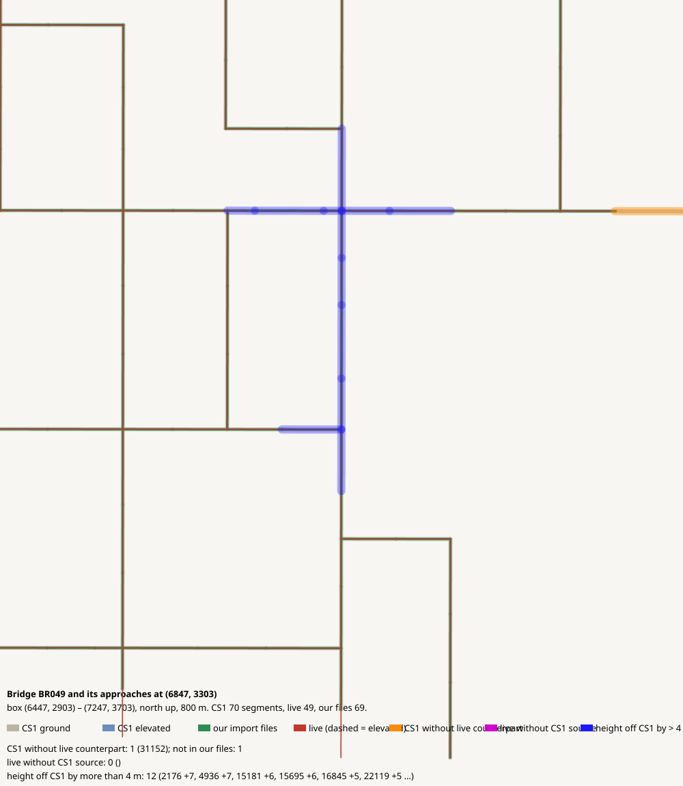

# Bridge BR049 and its approaches at (6847, 3303)

CHECK: 1 CS1 segments without live counterpart, 0 live without CS1 source, 12 more than 4 m off the CS1 height, 0 live dead ends CS1 did not have

| CS1 segment | prefab | elevation | in our files | live | converter fate |
|---|---|---:|---|---|---|
| 31152 | Gravel Road | 0 | no | missing | collapsed (< 4 m) |

| live segment | prefab | elevation |
|---|---|---:|

| CS1 segment | prefab | CS1 y | live | live − CS1 m |
|---|---|---:|---|---:|
| 2176 | Gravel Road | 139.4 | 1656420:5 Gravel Road | 6.9 |
| 4936 | Gravel Road Elevated | 139.4 | 1581719:5 Wooden Covered Bridge - 2 lanes | 7.3 |
| 15181 | Gravel Road | 139.4 | 1576721:5 Gravel Road | 6.4 |
| 15695 | Gravel Road | 139.4 | 1576694:5 Gravel Road | 5.8 |
| 16845 | Gravel Road | 139.4 | 1576826:5 Gravel Road | 4.5 |
| 22119 | Gravel Road | 139.4 | 1577123:5 Gravel Road | 4.5 |
| 22541 | Gravel Road | 139.4 | 1577052:5 Gravel Road | 6.8 |
| 23842 | Gravel Road | 139.4 | 1576992:5 Gravel Road | 4.9 |
| 24516 | Gravel Road Elevated | 139.4 | 1581718:5 Wooden Covered Bridge - 2 lanes | 7.5 |
| 24652 | Gravel Road | 139.4 | 1576992:5 Gravel Road | 7.4 |
| 34293 | Gravel Road | 139.4 | 1576407:5 Gravel Road | 8.0 |
| 35314 | Gravel Road | 139.4 | 1576377:5 Gravel Road | 6.0 |
