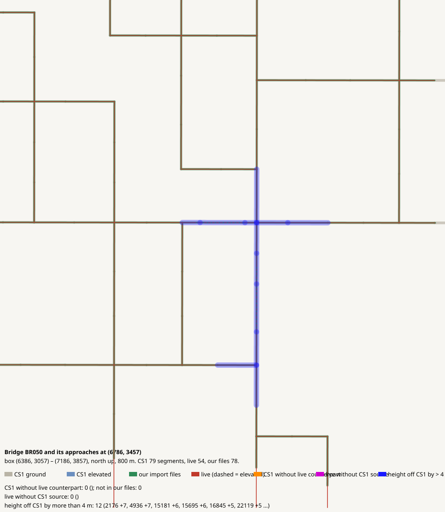

# Bridge BR050 and its approaches at (6786, 3457)

CHECK: 0 CS1 segments without live counterpart, 0 live without CS1 source, 12 more than 4 m off the CS1 height

| CS1 segment | prefab | elevation | in our files | live | converter fate |
|---|---|---:|---|---|---|

| live segment | prefab | elevation |
|---|---|---:|

| CS1 segment | prefab | CS1 y | live | live − CS1 m |
|---|---|---:|---|---:|
| 2176 | Gravel Road | 139.4 | 74189:19 Gravel Road | 6.9 |
| 4936 | Gravel Road Elevated | 139.4 | 95197:31 Wooden Covered Bridge - 2 lanes | 7.3 |
| 15181 | Gravel Road | 139.4 | 98222:25 Gravel Road | 6.4 |
| 15695 | Gravel Road | 139.4 | 98909:13 Gravel Road | 5.8 |
| 16845 | Gravel Road | 139.4 | 97745:15 Gravel Road | 4.5 |
| 22119 | Gravel Road | 139.4 | 99067:39 Gravel Road | 4.5 |
| 22541 | Gravel Road | 139.4 | 95546:19 Gravel Road | 6.8 |
| 23842 | Gravel Road | 139.4 | 98471:9 Gravel Road | 4.9 |
| 24516 | Gravel Road Elevated | 139.4 | 95198:31 Wooden Covered Bridge - 2 lanes | 7.5 |
| 24652 | Gravel Road | 139.4 | 98471:9 Gravel Road | 7.4 |
| 34293 | Gravel Road | 139.4 | 97935:17 Gravel Road | 8.0 |
| 35314 | Gravel Road | 139.4 | 97813:15 Gravel Road | 6.0 |
