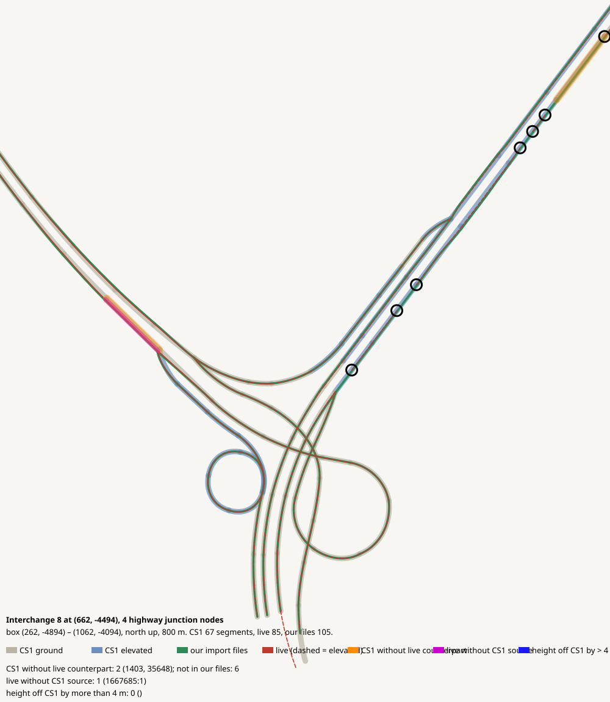

# Interchange 8 at (662, -4494), 4 highway junction nodes

CHECK: 2 CS1 segments without live counterpart, 1 live without CS1 source, 0 more than 4 m off the CS1 height, 7 live dead ends CS1 did not have ((944, -4288) (808, -4467) (723, -4579) (960, -4266) (976, -4245) (1054, -4142) (782, -4501))

| CS1 segment | prefab | elevation | in our files | live | converter fate |
|---|---|---:|---|---|---|
| 1403 | USRP 4L Interstate | 0 | no | missing | imported |
| 35648 | USRP 3L Interstate E | 48 | yes | missing | imported |

| live segment | prefab | elevation |
|---|---|---:|
| 1667685:1 | Highway Oneway - 4 lanes | 0.0 |

| CS1 segment | prefab | CS1 y | live | live − CS1 m |
|---|---|---:|---|---:|
