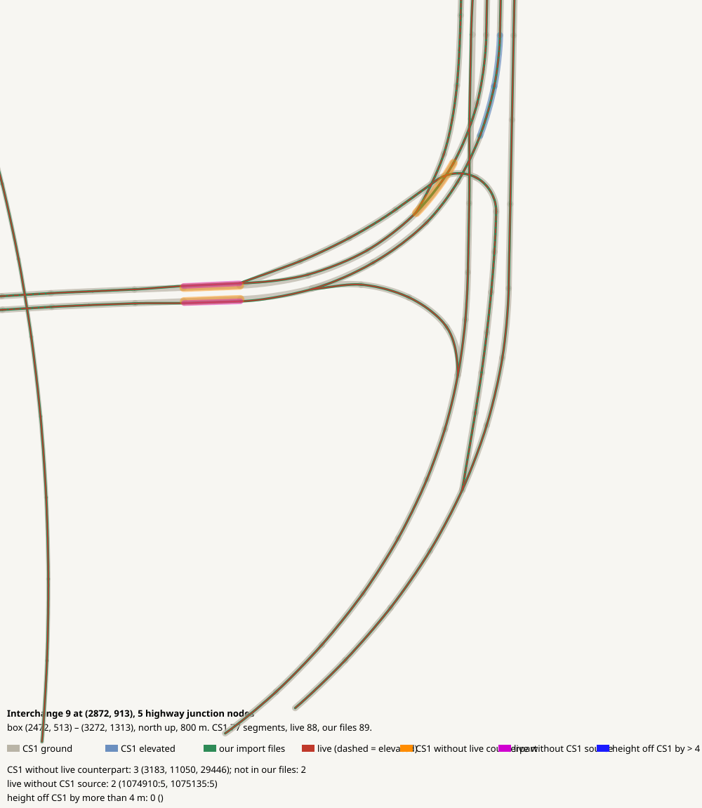

# Interchange 9 at (2872, 913), 5 highway junction nodes

CHECK: 3 CS1 segments without live counterpart, 2 live without CS1 source, 0 more than 4 m off the CS1 height, 0 live dead ends CS1 did not have

| CS1 segment | prefab | elevation | in our files | live | converter fate |
|---|---|---:|---|---|---|
| 3183 | USRP 2L Interstate E | 0 | yes | missing | imported |
| 11050 | USRP 4L Interstate | 0 | no | missing | imported |
| 29446 | USRP 3L Interstate | 0 | no | missing | imported |

| live segment | prefab | elevation |
|---|---|---:|
| 60514:3 | Highway Oneway - 3 lanes | 0.0 |
| 61326:3 | Highway Oneway - 4 lanes | 0.0 |

| CS1 segment | prefab | CS1 y | live | live − CS1 m |
|---|---|---:|---|---:|
