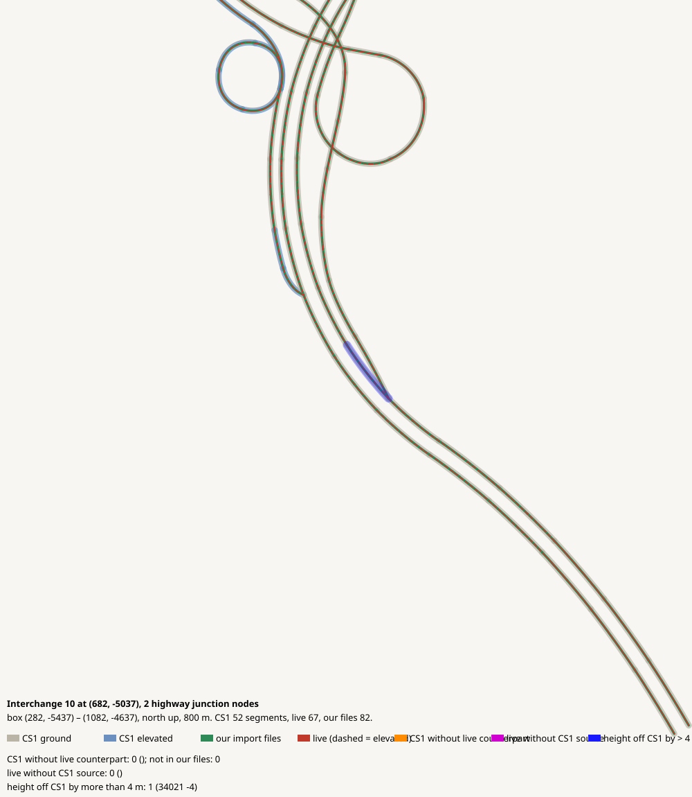

# Interchange 10 at (682, -5037), 2 highway junction nodes

CHECK: 0 CS1 segments without live counterpart, 0 live without CS1 source, 1 more than 4 m off the CS1 height

| CS1 segment | prefab | elevation | in our files | live | converter fate |
|---|---|---:|---|---|---|

| live segment | prefab | elevation |
|---|---|---:|

| CS1 segment | prefab | CS1 y | live | live − CS1 m |
|---|---|---:|---|---:|
| 34021 | USRP 2L Interstate E | 130.9 | 65624:5 Highway Oneway - 2 lanes | -4.3 |
