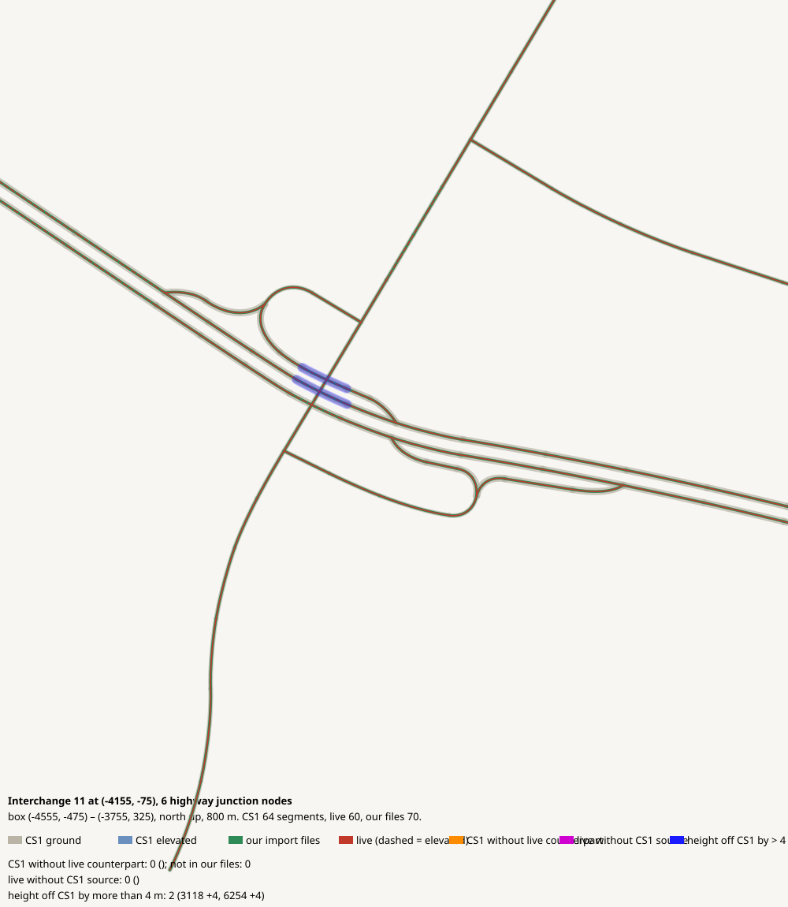

# Interchange 11 at (-4155, -75), 6 highway junction nodes

CHECK: 0 CS1 segments without live counterpart, 0 live without CS1 source, 2 more than 4 m off the CS1 height

| CS1 segment | prefab | elevation | in our files | live | converter fate |
|---|---|---:|---|---|---|

| live segment | prefab | elevation |
|---|---|---:|

| CS1 segment | prefab | CS1 y | live | live − CS1 m |
|---|---|---:|---|---:|
| 3118 | USRP 1L Interstate Ramp E | 161.4 | 61973:3 Highway Oneway - 1 lane | 4.0 |
| 6254 | USRP 2L Interstate E | 161.4 | 63448:7 Highway Oneway - 2 lanes | 4.3 |
