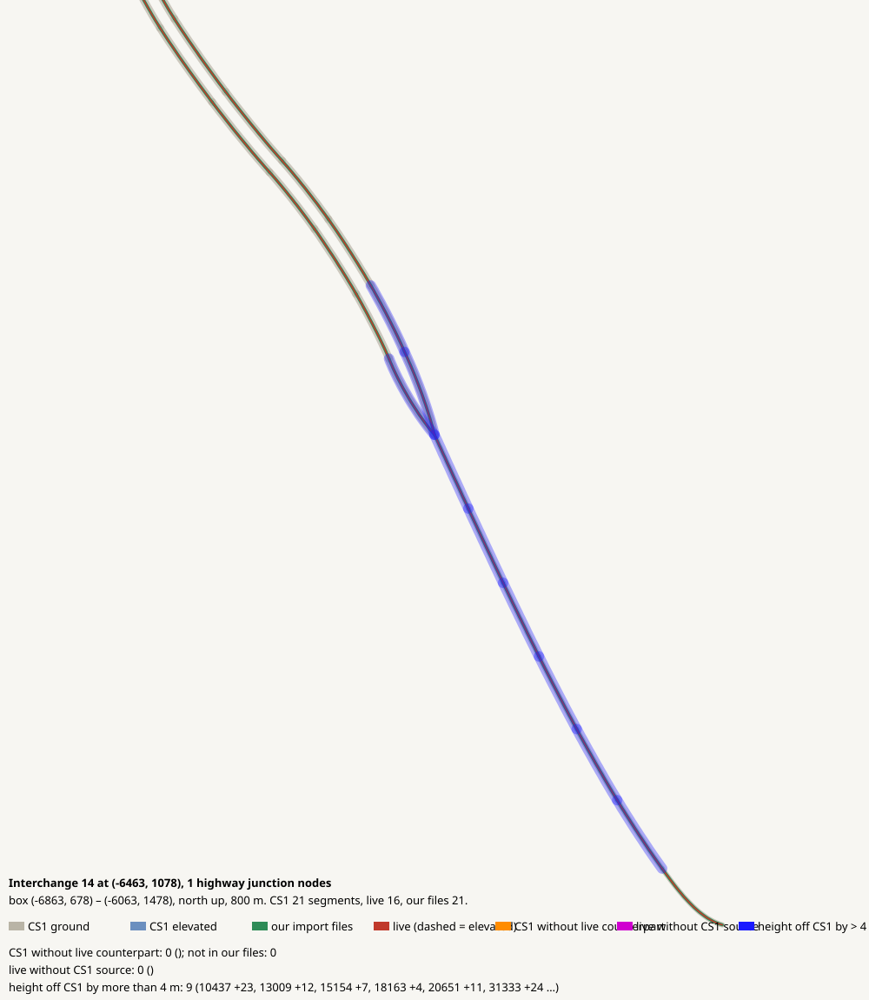

# Interchange 14 at (-6463, 1078), 1 highway junction nodes

CHECK: 0 CS1 segments without live counterpart, 0 live without CS1 source, 9 more than 4 m off the CS1 height, 0 live dead ends CS1 did not have

| CS1 segment | prefab | elevation | in our files | live | converter fate |
|---|---|---:|---|---|---|

| live segment | prefab | elevation |
|---|---|---:|

| CS1 segment | prefab | CS1 y | live | live − CS1 m |
|---|---|---:|---|---:|
| 10437 | USRP 4-Lane National Road | 241.7 | 618415:1 Medium Road | 23.5 |
| 13009 | USRP 4-Lane National Road | 257.1 | 618900:1 Medium Road | 12.4 |
| 15154 | USRP 2L Interstate | 262.8 | 1667687:1 Highway Oneway - 2 lanes | 7.0 |
| 18163 | USRP 2L Interstate | 264.1 | 1667673:1 Highway Oneway - 2 lanes | 4.3 |
| 20651 | USRP 4-Lane National Road | 253.3 | 619316:1 Medium Road | 11.0 |
| 31333 | USRP 4-Lane National Road | 245.6 | 619316:1 Medium Road | 24.0 |
| 31696 | USRP 2L Interstate | 262.8 | 1667449:1 Highway Oneway - 2 lanes | 5.9 |
| 32978 | USRP 4-Lane National Road | 249.4 | 619316:1 Medium Road | 20.1 |
| 34976 | USRP 4-Lane National Road | 261.1 | 619163:1 Medium Road | 11.3 |
