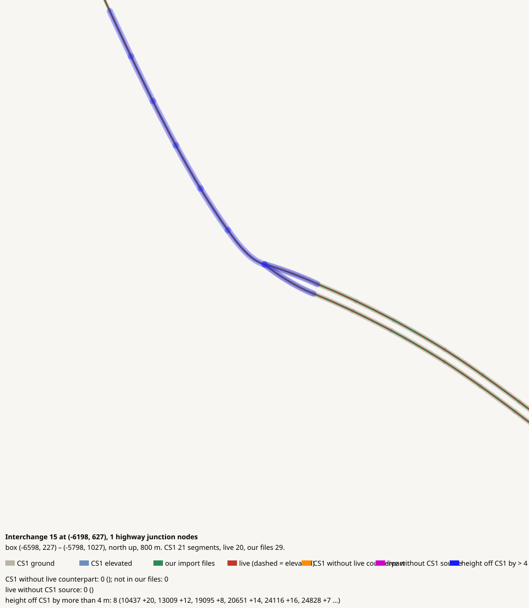

# Interchange 15 at (-6198, 627), 1 highway junction nodes

CHECK: 0 CS1 segments without live counterpart, 0 live without CS1 source, 8 more than 4 m off the CS1 height, 0 live dead ends CS1 did not have

| CS1 segment | prefab | elevation | in our files | live | converter fate |
|---|---|---:|---|---|---|

| live segment | prefab | elevation |
|---|---|---:|

| CS1 segment | prefab | CS1 y | live | live − CS1 m |
|---|---|---:|---|---:|
| 10437 | USRP 4-Lane National Road | 241.7 | 93847:7 Medium Road | 23.5 |
| 13009 | USRP 4-Lane National Road | 257.1 | 97837:13 Medium Road | 12.4 |
| 19095 | USRP 2L Interstate | 235.9 | 65834:5 Highway Oneway - 2 lanes | 8.0 |
| 20651 | USRP 4-Lane National Road | 253.3 | 99337:41 Medium Road | 11.0 |
| 24116 | USRP 4-Lane National Road | 237.8 | 98069:15 Medium Road | 16.1 |
| 24828 | USRP 2L Interstate | 235.9 | 65477:7 Highway Oneway - 2 lanes | 6.9 |
| 31333 | USRP 4-Lane National Road | 245.6 | 99337:41 Medium Road | 24.0 |
| 32978 | USRP 4-Lane National Road | 249.4 | 99337:41 Medium Road | 20.1 |
