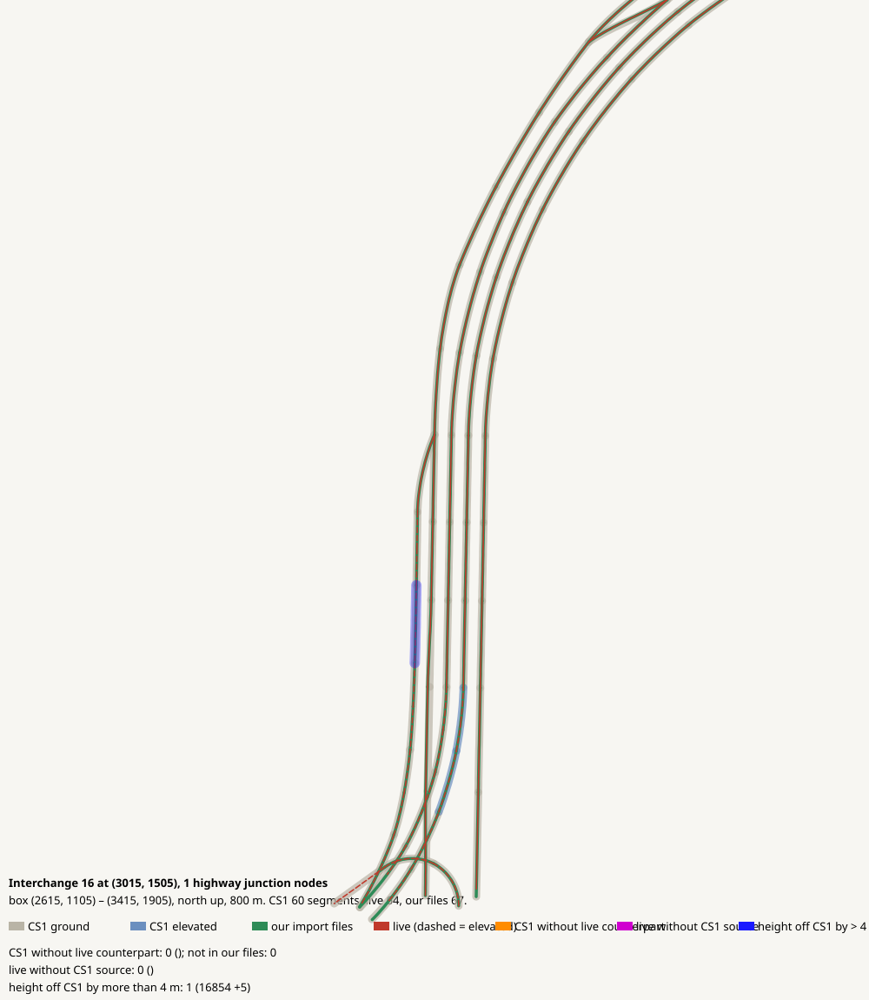

# Interchange 16 at (3015, 1505), 1 highway junction nodes

OK: layout and heights match CS1 (2 m in plan, 4 m in height)

| CS1 segment | prefab | elevation | in our files | live | converter fate |
|---|---|---:|---|---|---|

| live segment | prefab | elevation |
|---|---|---:|

| CS1 segment | prefab | CS1 y | live | live − CS1 m |
|---|---|---:|---|---:|
